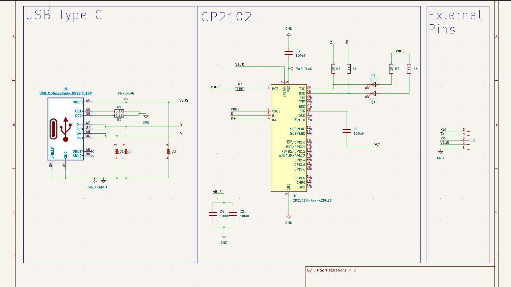
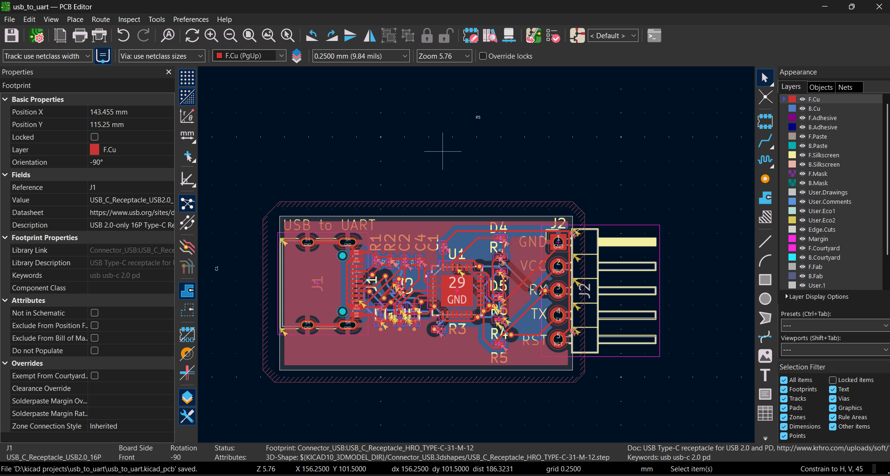
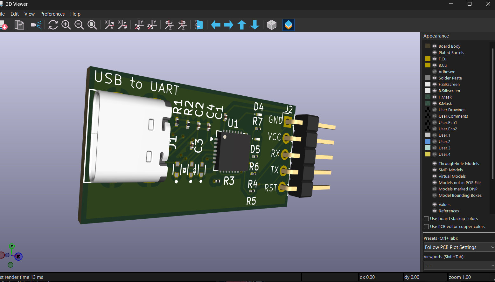

# USB-to-UART Converter PCB

A USB-to-UART converter PCB designed using KiCad as a learning project to understand the basic PCB design workflow.

## Overview

The board uses the CP2102N USB-to-UART bridge to provide communication between a computer's USB interface and a microcontroller's UART interface.

The PCB uses a USB Type-C connector as the USB interface and provides an external UART header.

## Main Components

- CP2102N USB-to-UART bridge
- USB Type-C receptacle
- ESD protection diode
- SMD resistors and capacitors
- Status LEDs
- 5-pin UART header

## KiCad Design Workflow

- Schematic capture
- Component selection
- Footprint assignment
- Custom footprint/library integration
- PCB component placement
- PCB routing
- Via usage
- Ground plane
- Design Rule Checking (DRC)
- 3D PCB visualization

## Schematic

The circuit schematic showing the CP2102N USB-to-UART interface and its associated components.

## PCB Layout

The PCB layout showing component placement, track routing, vias, and ground plane.

## 3D View

3D visualization of the designed PCB, showing the component arrangement and board layout.

## Tools

- KiCad
- CP2102N USB-to-UART bridge

## Project Status and Limitations

Completed as a learning/prototype project to understand the basic KiCad PCB design workflow.

> **Note:** This project was developed as a learning exercise by following a guided tutorial. The PCB layout currently has some unresolved Design Rule Check (DRC) errors, mainly related to routing. These issues were not fully resolved during the project.

The design is intended for learning and portfolio demonstration and has not been validated for manufacturing or real-world hardware operation.

## Acknowledgement

This project was developed as a learning exercise based on a guided USB-to-UART PCB design tutorial. The design was recreated independently to gain practical exposure to KiCad schematic capture, component placement, PCB routing, and layout design.
